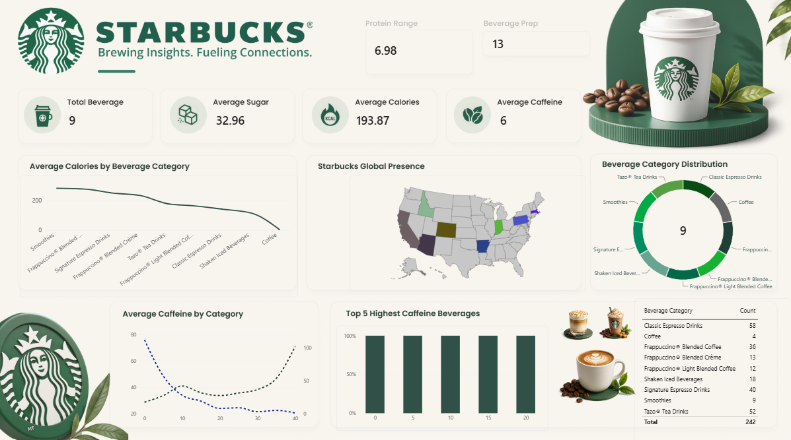

# Starbucks Data Analysis Dashboard

An interactive Power BI dashboard for analyzing Starbucks beverage data, nutritional attributes, beverage categories, and global presence.

## Dashboard Preview



## Project Overview

This project uses Power BI to analyze Starbucks beverage data and present key metrics through interactive visualizations. It helps users explore beverage categories, nutritional information, caffeine levels, and geographic distribution.

## Key Features

- **KPI Cards:** Total beverages, average sugar, average calories, average caffeine, protein range, and beverage preparation.
- **Calories Analysis:** Compares average calories across beverage categories.
- **Global Presence:** Maps Starbucks locations using geographic data.
- **Category Distribution:** Displays the distribution of beverages by category.
- **Caffeine Analysis:** Compares average caffeine levels across categories.
- **Highest Caffeine Beverages:** Visualizes selected high-caffeine beverages.
- **Category Summary:** Shows the number of records in each beverage category.

## Tools and Technologies

- Power BI Desktop
- CSV datasets
- Data visualization
- Git and GitHub

## Repository Structure

```text
Starbucks-Data-Analysis/
├── Starbucks_Analysis.pbix
├── starbucks.csv
├── directory.csv
├── Classic Espresso.png
├── Frappuccino Blended coffee.png
├── bg.png
├── coffee.png
├── dashboard-preview.png
├── LICENSE
└── README.md
```

## How to Run

1. Clone or download this repository.
2. Install and open Power BI Desktop.
3. Open `Starbucks_Analysis.pbix`.
4. Update the CSV file paths if prompted.
5. Refresh the data and explore the dashboard.

## Key Questions

- How do calories vary across beverage categories?
- Which beverage categories have the most records?
- How does caffeine content vary across categories?
- Which beverages have the highest caffeine values?
- What geographic patterns appear in the location data?

## Future Improvements

- Add interactive filters for beverage categories and nutritional attributes.
- Document the data-cleaning process and DAX measures.
- Add more detailed nutritional comparisons.
- Include additional dashboard screenshots and insights.

## Author

**Kanishka Rani**
---

If you find this project useful, consider giving the repository a star!
